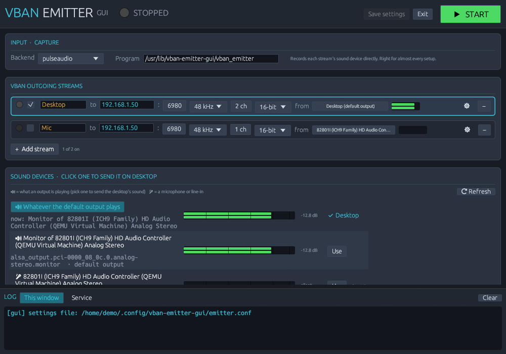

# VBAN Emitter GUI

A desktop app for Linux that sends your computer's sound over the network as [VBAN](https://vb-audio.com/Voicemeeter/vban.htm)
streams, by driving the `vban_emitter` program from [quiniouben/vban](https://github.com/quiniouben/vban).
Pick what each stream sends with live level meters, then let a user service send it every time you log in.
It only sends; it doesn't receive or mix.

Made for PipeWire and PulseAudio desktops (tested on Linux Mint 22), sending to Voicemeeter or any other VBAN receiver.

## What it does

- **Any number of streams.** Each one is a short row: on/off, stream name, destination IP and port, sample rate,
  channels, format, and the sound device it sends. **+ Add stream** and **−** add and remove them.
- **Sound devices with live meters.** Every PulseAudio/PipeWire source is listed with a level meter, so it's easy to
  see which is which. 🔊 is what an output is playing (pick one of these to send the desktop's sound), 🎤 is a
  microphone or line-in. Click one to send it on the selected stream; if that stream is live, it switches at once.
  A test tone on any output shows which meter belongs to it.
- **A status light per stream.** Green when the stream is being sent and the receiver answers a VBAN ping
  (Voicemeeter does, and the tooltip names it), amber when it's sent but nothing answers, grey when it isn't sent.
- **Runs as a user service.** One click installs `vban-emitter-gui.service`, which sends every stream that's on, now
  and at every login, and restarts any stream that stops. START/STOP at the top drives the service once it's
  installed.
- **Takes over a hand-made setup.** It lists every running `vban_emitter` and other VBAN user services, can copy an
  emitter's settings into a stream, and can turn an old service off (keeping its files).
- **Stays out of the way.** One copy at a time; closing the window hides it to the tray (`--tray` starts it there).

## Install

1. Install the `.deb` from the releases (or build it, below):

       sudo apt install ./vban-emitter-gui_*_amd64.deb

   It includes `vban_emitter` 2.2.0 from [quiniouben/vban](https://github.com/quiniouben/vban), so nothing else is
   needed. If you've built your own `vban_emitter`, you can point the app at it instead (Program, in the Input strip).
2. Open **VBAN Emitter GUI** from the menu, set the destination, pick a sound device, and press **START**, or
   **Install & start** to have it send at every login.

## How it runs

- Settings live in `~/.config/vban-emitter-gui/emitter.conf`: `program` and `backend`, then a `[stream]` section for
  each stream. They can be edited by hand; the service reads them each time it starts.
- The service runs `vban-emitter-gui --run`, which starts one `vban_emitter` per stream that's on and watches them.
  Its output goes to `~/.local/state/vban-emitter-gui/service.log`, shown in the window's Service log tab.
- With the pulseaudio backend (the default, and right for PipeWire too) each emitter records its device directly
  (`-d`). With the alsa backend the emitter records through ALSA and its recording stream is then moved to the
  device with `pactl move-source-output`.
- The meters and the test tone use `parec` and `pacat`; device lists come from `pactl`.

## Build

    sudo apt install libgtk-3-dev libxdo-dev libayatana-appindicator3-dev cmake libasound2-dev libpulse-dev
    cargo build --release
    sh packaging/build-deb.sh      # writes target/vban-emitter-gui_<version>_amd64.deb

`build-deb.sh` also downloads and builds vban's pinned release (v2.2.0) to include it in the package.

At run time it needs `pulseaudio-utils` (`pactl`, `parec`, `pacat`), systemd, and for the tray icon
libayatana-appindicator3.

## License

BSD 2-Clause; see [LICENSE](LICENSE). The `vban_emitter` included in the package is vban's, unchanged, under
GPL-3.0; the package carries its license and full source in `/usr/share/doc/vban-emitter-gui/vban/`.

VBAN and Voicemeeter are VB-Audio's. This project isn't made by or connected with VB-Audio.
